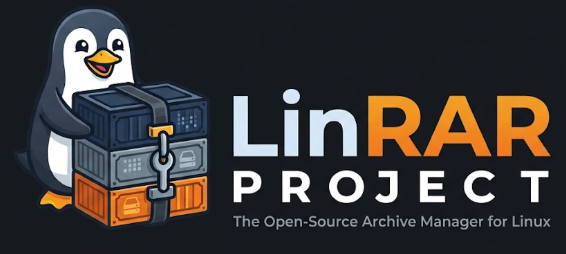

<p align="center">
  
</p>

<p align="center">
  <strong>Modern, High-Performance Universal Archive Manager for Linux</strong>
  <br>
  <em>Built in 100% Pure Safe Rust 2024 with Native Wayland/X11 GUI & Powerful CLI</em>
</p>

<p align="center">
  <a href="#license"></a>
  <a href="#version"></a>
  <a href="#rust"></a>
  <a href="#platform"></a>
  <a href="#security"></a>
</p>

---

## Overview

**LinRAR** is an independent, high-performance, open-source universal archive manager designed specifically for Linux. Built from the ground up in pure Rust 2024, LinRAR provides a fast, secure, and native archiving experience for both desktop users and power users through an intuitive **GUI** (powered by `eframe` / `egui`) and an ergonomic, scriptable **CLI**.

LinRAR features full format interoperability (RAR4, RAR5, ZIP, TAR.GZ, TAR.BZ2, 7z), built-in recovery records, archive locking, damaged archive repair, multi-threaded hardware benchmarking, built-in heuristic threat scanning with optional ClamAV daemon integration, and custom theme modes (Dark & Light).

---

## Key Features

### 1. Comprehensive Archive Management
- **Archive Extraction & Creation**: Support for `.rar`, `.zip`, `.tar.gz`, `.tar.bz2`, and `.7z`.
- **Solid Archives**: Maximize compression ratio for groups of similar files.
- **Recovery Records & Damaged Archive Repair**: Protect archives against silent bit rot or byte corruptions and automatically reconstruct damaged archives.
- **Archive Locking**: Lock archives to prevent accidental deletion, tampering, or modifications.
- **Multi-Volume Archives**: Automatically split huge files into smaller volumes (`-v<size>`).
- **Archive Comments**: Embed UTF-8 comments directly into archives, viewable in a collapsible side pane in the GUI.
- **Self-Extracting Archives (SFX)**: Create standalone executable archives for Linux.
- **Archive Format Converter**: Convert between archive formats in one click or command.
- **Hardware Benchmark**: Real-time multi-core CPU and memory compression stress-testing tool.

### 2. Dual Themes (Dark & Light)
- **Dark Theme**: Default sleek cyberpunk dark palette designed for low-light environments.
- **Light Theme**: Crisp, high-contrast light theme engineered for daytime readability and accessibility.
- **Instant Switching**: Switch themes in real-time via the `Theme` menu (`Dark Theme` / `Light Theme`) without restarting the application.

### 3. Integrated Security & Virus Scanner
- **Dual Engine Architecture**:
  - **Embedded Heuristics Engine**: Instantly inspects archive contents for suspicious anomalies, including double extensions (`report.pdf.sh`), forbidden Unix executables (`.elf`, `.bin`, `.so`), nested scripts, and directory traversal / Zip Slip exploits (`../`).
  - **ClamAV Integration**: Automatically detects and leverages `clamscan` or ClamAV daemon (`clamd`) if available on your system for deep signature-based malware detection.
- **Real-Time Scanning**: Scan archives with `Alt+S` in the GUI or `linrar scan <file>` in the CLI.

---

## Installation

### Prerequisites
- Linux (Ubuntu, Debian, Fedora, Arch, or openSUSE)
- Rust toolchain (`cargo`, `rustc` 1.80+)
- Optional: ClamAV (`sudo apt install clamav clamav-daemon`) for deep malware scanning.

### One-Click Installer
Clone the repository and run the automated installer:
```bash
git clone https://github.com/fahmikemal/LinRAR.git
cd LinRAR
chmod +x install.sh
./install.sh
```

The installer builds the release binary, installs it to `~/.local/bin/linrar`, installs high-resolution icons into `~/.local/share/icons/hicolor/`, and registers the desktop launcher in your application menu (`LinRAR Archive Manager`).

### Manual Build
```bash
cargo build --release
sudo cp target/release/linrar /usr/local/bin/
```

---

## Usage

### Graphical User Interface (GUI)
Launch LinRAR from your desktop application launcher or run:
```bash
# Open LinRAR in File Manager mode
linrar

# Open a specific archive directly
linrar payload.rar
```

#### GUI Keyboard Shortcuts
| Shortcut | Action |
| :--- | :--- |
| `Ctrl + O` | Open archive file dialog |
| `Alt + A` | Add files to archive |
| `Alt + E` | Extract to folder |
| `Alt + T` | Test archive integrity |
| `Alt + S` | Scan archive for viruses & threats |
| `Alt + R` | Repair damaged archive |
| `Alt + Q` | Convert archive format |
| `Alt + F` | Find files within archive |
| `Alt + B` | Launch hardware benchmark |
| `Alt + I` | View archive information |
| `Ctrl + R` | Generate file report |
| `F2` | Rename selected file |
| `Del` | Delete selected file |

---

### Command Line Interface (CLI)

LinRAR provides commands matching standard archive tooling:

```bash
# Create a new archive
linrar a archive.rar document.txt photos/

# Create a solid archive with recovery record (3%)
linrar a -s -rr3 archive.rar big_data/

# Split into 50MB volumes
linrar a -v50m split_archive.rar large_file.iso

# Extract files to current directory
linrar x archive.rar

# Extract files to a destination directory
linrar x archive.rar /path/to/destination/

# List contents of an archive
linrar l archive.rar

# Test archive integrity
linrar t archive.rar

# Scan archive for viruses & suspicious files
linrar scan archive.rar

# Repair a damaged archive
linrar r corrupted.rar

# Convert archive format (e.g. zip to rar)
linrar q source.zip target.rar

# Run multi-threaded hardware benchmark
linrar b
```

---

## Project Structure

```
linrar/
├── assets/
│   ├── icons/                 # App icons, toolbar icons, and about banner
│   └── linrar_banner_dark.png # High-resolution project banner
├── src/
│   ├── core/                  # Engines (RAR, ZIP, TAR), repair, scanner, benchmark, converter
│   ├── gui/                   # Native GUI application (eframe/egui), dialogs, and themes
│   ├── cli.rs                 # CLI command parsing and handlers
│   ├── types.rs               # Common data structures and archive types
│   ├── lib.rs                 # Core library export
│   └── main.rs                # Executable entry point
├── install.sh                 # One-click desktop installer script
├── linrar.desktop             # Linux XDG desktop entry
├── Cargo.toml                 # Cargo package configuration and dependencies
└── LICENSE                    # MIT License
```

---

## License

LinRAR is licensed under the [MIT License](LICENSE).  
Copyright (c) 2026 LinRAR Team.
